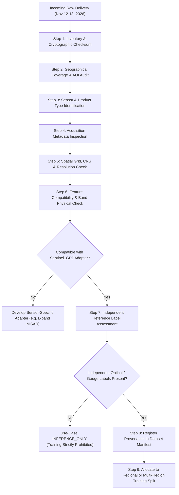

# Earth Pulse — Standard Operating Procedure: Incoming Dataset Intake & Readiness Protocol
**Target Data Drop Window:** November 12–13, 2026  
**Project:** NASA Space Apps Challenge 2026 — *"Dancing with the SARs"*  
**System:** Earth Pulse Multi-Region Extensible SAR Machine Learning Framework  
**Document Version:** 1.0.0  
**Effective Date:** November 3, 2026  

---

## 1. Context and Objective

An unconfirmed external data drop is expected around **November 12–13, 2026**. The sensor type, frequency band, polarization, resolution, and geographical coverage of this delivery are currently unverified (it may contain additional Sentinel-1 passes, new regional scenes such as Patna/Ganges River, or alternative SAR platforms such as NISAR or ALOS-2).

To prevent pipeline disruptions, corrupted training splits, or uncalibrated cross-frequency model degradation, this Standard Operating Procedure (SOP) defines the mandatory **9-Step Intake Protocol**. Under no circumstances should incoming data be directly routed into training or operational inference without completing this verification workflow.



---

## 2. The 9-Step Intake Protocol

### Step 1: File Inventory & Cryptographic Integrity
1. Record file path, archive structure, file size (bytes), and MIME type.
2. Calculate and log the SHA-256 checksum immediately upon arrival.
3. Compare against transfer manifests (if provided) to confirm zero bit-corruption.

### Step 2: Geographical Coverage Audit
1. Inspect the spatial bounding box (WGS 84 latitude/longitude).
2. Determine whether the scene intersects:
   - Existing Jamuna study area (`jamuna_sirajganj`).
   - A new discrete geographic region (e.g., Patna, India).
3. If covering a new region, generate a new region configuration file in `configs/regions/<region_id>.yaml` adhering to the standard schema. Do not mix coordinate frames.

### Step 3: Sensor & Product Type Identification
1. Identify the sensor platform (e.g., Sentinel-1A/B, NISAR, ALOS-2, TerraSAR-X).
2. Identify the product level:
   - Level-1 Single Look Complex (SLC)
   - Level-1 Ground Range Detected (GRD)
   - Level-2 Geocoded Covariance (GCOV) / Radiometrically Terrain Corrected (RTC).
3. Check mode: Interferometric Wide (IW), Stripmap, or ScanSAR.

### Step 4: Acquisition Metadata Inspection
1. Extract acquisition timestamp (UTC).
2. Determine pass direction (Ascending / Descending) and relative orbit number.
3. Determine radar frequency band:
   - **C-band ($\sim 5.405\text{ GHz}$, $\lambda \approx 5.55\text{ cm}$)**: Directly compatible with Sentinel-1 adapters.
   - **L-band ($\sim 1.25\text{ GHz}$, $\lambda \approx 24\text{ cm}$)**: Canopies and flooded vegetation produce strong double-bounce. **Cross-frequency direct substitution is prohibited.** Requires a dedicated L-band adapter.
   - **X-band ($\sim 9.6\text{ GHz}$, $\lambda \approx 3.1\text{ cm}$)**: Surface roughness sensitive; requires dedicated calibration.
4. Verify available polarizations (dual-pol VV/VH, quad-pol, or single-pol).

### Step 5: Spatial Grid, CRS & Resolution Verification
1. Open raster headers via GDAL (`osgeo.gdal`).
2. Identify native Projected Coordinate Reference System (CRS).
3. Verify pixel spacing (e.g., $20.0\text{ m} \times 20.0\text{ m}$).
4. If CRS or resolution differs from canonical grid:
   - Apply area-weighted resampling (`gdal.GRA_Average` or `gdal.GRA_Bilinear`).
   - Store resampled outputs in `data/processed/aligned/`.

### Step 6: Feature Compatibility Assessment
1. Inspect available channels: does the dataset support extraction of the required 6 Earth Pulse features (`vv_db`, `vh_db`, `vv_minus_vh_db`, `cross_pol_ratio`, `texture_vv`, `texture_vh`)?
2. Validate whether backscatter intensities fall within physically valid limits:
   - VV: $[-35.0, +15.0]\text{ dB}$
   - VH: $[-40.0, +5.0]\text{ dB}$
3. If sensor is non-Sentinel-1, route through `SensorAdapterRegistry.validate_sensor_compatibility()`. If incompatible, trigger sensor adapter development prior to ingestion.

### Step 7: Independent Reference Label Assessment
1. Inspect whether simultaneous or near-simultaneous ($\Delta t \le 3\text{ days}$) independent optical reference data (Sentinel-2 SCL, Landsat 8/9, PlanetScope) or in-situ water level gauge records exist.
2. If optical data is available, compute cloud cover percentage.
3. If no independent reference labels are available, **the dataset is strictly designated as `INFERENCE_ONLY`**. Self-labeling or using model predictions as training labels is strictly forbidden.

### Step 8: Provenance Registration
1. Ingest dataset record into `data/metadata/dataset_manifest.json` using `src.core.dataset_manifest.DatasetManifest`.
2. Populate all 12 mandatory fields:
   - `dataset_id`
   - `region_id`
   - `sensor`
   - `product_type`
   - `acquisition_date`
   - `polarization`
   - `spatial_resolution_m`
   - `crs`
   - `source_path`
   - `reference_label_availability`
   - `quality_status`
   - `sha256`
   - `processing_version`

### Step 9: Use-Case Determination
Assign the dataset to one of three operational categories:
1. **`REGIONAL_AND_MULTI_REGION_TRAINING`**: Sensor is compatible, physical bounds are satisfied, and high-quality independent ground-truth labels exist. Dataset is assigned $1\text{ km}$ spatial blocks for grouped partitioning.
2. **`INFERENCE_ONLY`**: Sensor is compatible, but independent ground-truth labels are absent or cloud-obscured ($> 85\%$). Dataset can be processed for flood inundation mapping using validated models, but cannot enter training sets.
3. **`REQUIRES_ADAPTER_DEVELOPMENT`**: Sensor utilizes a new frequency band (e.g. L-band NISAR) or missing polarizations. A new sensor adapter must be developed and validated before use.

---

## 3. Executable Verification Tooling

Operators can execute the intake protocol directly via the command-line utility:

```bash
# Example 1: Ingesting an incoming Sentinel-1 scene for Jamuna
python3 scripts/intake_dataset.py \
  --file data/incoming/S1A_IW_GRDH_20241112.zip \
  --region-hint jamuna_sirajganj \
  --sensor-hint sentinel1 \
  --out-json data/metadata/intake_reports/intake_20241112.json

# Example 2: Ingesting a new region dataset (e.g. Patna, India)
python3 scripts/intake_dataset.py \
  --file data/incoming/patna_sar_20241113.tif \
  --region-hint patna_ganges \
  --sensor-hint sentinel1 \
  --out-json data/metadata/intake_reports/intake_patna_20241113.json
```

