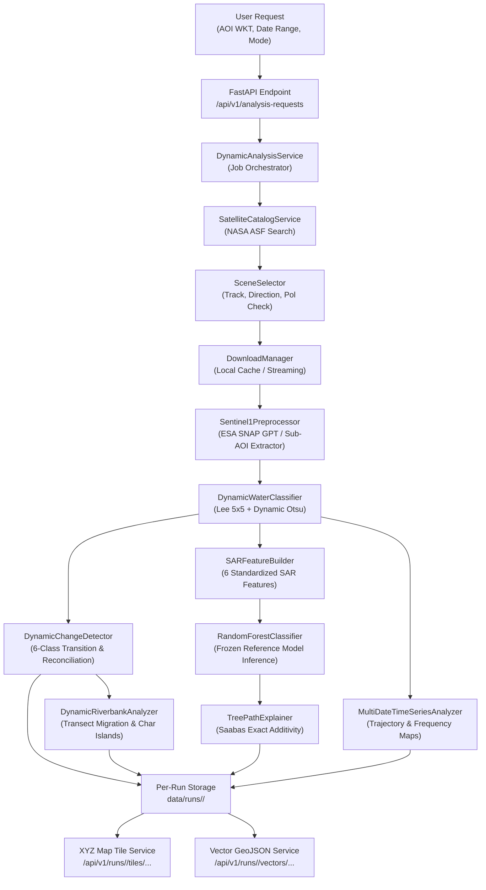

# EARTH PULSE — DYNAMIC ANALYSIS ARCHITECTURE

**Project:** NASA Space Apps Challenge 2026 — Dancing with the SARs  
**Application:** Earth Pulse / EarthPulse-SAR  
**Scope:** Dynamic Satellite Observation, Time-Series Intelligence & Explainable AI Backend  
**Date:** November 2026  
**Status:** Authoritative Architectural Specification  

---

## 1. EXECUTIVE ARCHITECTURAL SUMMARY

Earth Pulse has evolved from a static, historical two-date demonstration (June 10 and July 16, 2024) into a generalized, data-driven environmental observation and change-analysis backend. The platform now supports user-specified dates, arbitrary bounding boxes and sub-AOIs within the Jamuna River reach, multi-date chronological time-series sequences, and on-demand AI inference with Saabas tree-path feature attribution.

The architecture preserves all authoritative Phase 1–7 scientific algorithms, the frozen Random Forest model artifact (`phase7a_rf_jamuna_v1`), and reference benchmarks while introducing modular, stateless pipeline operators and a persistent, asynchronous job execution lifecycle.

---

## 2. SYSTEM TOPOLOGY & DIRECTORY STRUCTURE

```text
EarthPulse-SAR/
├── configs/
│   ├── features/                      # Authoritative 6-feature SAR schemas
│   ├── models/                        # Model definitions & hyperparameters
│   ├── processing/                    # Preprocessing & filtering parameters
│   └── regions/                       # Jamuna regional definitions & bounds
├── data/
│   ├── intermediate/                  # SNAP BEAM-DIMAP intermediate products
│   ├── metadata/                      # SQLite database & provenance ledgers
│   ├── outputs/                       # Authoritative historical outputs (Phase 2-7)
│   ├── processed/                     # Aligned & calibrated reference GeoTIFFs
│   ├── raw/                           # Cached raw Sentinel-1 archives
│   └── runs/                          # Per-run isolated storage (<run_id>/)
│       └── <run_id>/
│           ├── request.json           # Ingested AOI & date parameters
│           ├── scenes.json            # Discovered & selected Sentinel-1 scenes
│           ├── summary.json           # Scientific results, areas, & accounting
│           ├── timeseries.json        # Chronological trajectories & frequencies
│           ├── explanations.json      # XAI attributions & additivity checks
│           ├── rasters/               # Calibrated SAR, water masks, transitions
│           └── vectors/               # Inundation GeoJSON clusters
├── docs/                              # Technical reports & integration guides
├── graphs/
│   └── s1_grd_calibration_terrain_correction.xml # Canonical 8-node SNAP graph
├── models/
│   ├── experimental/                  # Versioned candidate models (v2)
│   ├── model_registry.json            # Immutable model version ledger
│   └── phase7a/
│       └── phase7a_random_forest_model.joblib # Frozen reference model
├── scripts/                           # Historical benchmarking & pipeline runners
├── src/
│   ├── acquisition/                   # Dynamic NASA data discovery & caching
│   │   ├── asf_client.py              # NASA ASF DAAC search wrapper
│   │   ├── download_manager.py        # Chunked download streaming & resume
│   │   └── scene_selector.py          # Orbital geometry & comparability rules
│   ├── backend/                       # FastAPI web services & SQLite persistence
│   │   ├── api/v1/endpoints/          # REST routes & XYZ tile endpoints
│   │   ├── database/                  # SQLite schema & row factory
│   │   └── services/                  # Business logic & analysis orchestration
│   ├── core/                          # Authentication & catalog orchestration
│   │   ├── earthdata_auth.py          # NASA Bearer Token & .netrc credentials
│   │   └── satellite_catalog.py       # Discovery service & endpoint health checks
│   ├── ml/                            # Machine learning & Explainable AI
│   │   ├── adapters.py                # Sensor feature extraction & physics checks
│   │   ├── explainability.py          # Saabas additive tree-path explainer
│   │   ├── random_forest.py           # Pure-NumPy vectorized Decision Tree & RF
│   │   ├── registry.py                # Model registry and metadata schemas
│   │   └── training/                  # Spatial/temporal train-val-test framework
│   └── pipeline/                      # Scientific raster processing modules
│       ├── change_detection.py        # 6-class transitions & area reconciliation
│       ├── feature_builder.py         # 6-feature tensor extraction for ML
│       ├── riverbank_analysis.py      # Transect displacement & char submergence
│       ├── sentinel1_preprocess.py    # SNAP GPT runner & sub-AOI extraction
│       ├── time_series.py             # Multi-date sequence & inundation frequency
│       └── water_classification.py    # Lee 5x5 filtering & dynamic Otsu
├── tests/                             # 388 comprehensive automated tests
└── tools/                             # CLI utilities for auth, setup & demo
```

---

## 3. COMPONENT LIFECYCLE & DATAFLOW



---

## 4. SCIENTIFIC INVARIANTS & INTEGRITY CONSTRAINTS

1. **Strict Area Conservation:**
   $$\text{Net Candidate Water Change} = \text{Gross Inundation} - \text{Gross Recession} = \text{Valid Water}(t_2) - \text{Valid Water}(t_1)$$
   The valid common comparison domain must remain strictly separated from NoData and numerical indeterminate noise floors.
2. **Empirical Observation Grounding:**
   The backend never fabricates, interpolates, or forecasts water extents for dates without genuine satellite acquisitions.
3. **Immutability of Historical Reference:**
   Original Sentinel-1 GRD archives, Phase 5 flood masks, Phase 6 riverbank migration products, and the frozen Random Forest artifact (`85038f0f...`) remain unaltered.
4. **Dynamic Spatial Referencing:**
   All newly preprocessed rasters strictly maintain EPSG:32645 (WGS 84 / UTM zone 45N) with 20.0 m x -20.0 m pixel resolution snapped to standard grid origins.
