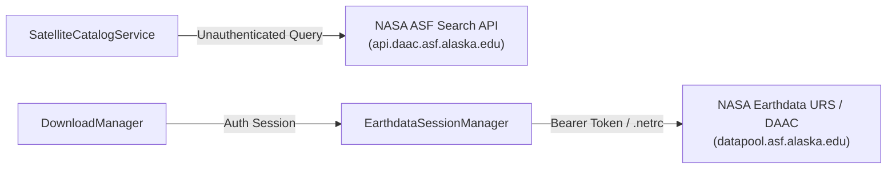

# EARTH PULSE — NASA EARTHDATA & ASF INTEGRATION GUIDE

**Project:** NASA Space Apps Challenge 2026 — Dancing with the SARs  
**Application:** Earth Pulse / EarthPulse-SAR  
**Scope:** Secure Credential Management, Public Catalog Discovery & Protected DAAC Retrieval  
**Date:** November 2026  
**Status:** Authoritative Operational Guide  

---

## 1. INTEGRATION ARCHITECTURE

Earth Pulse interfaces directly with the NASA Alaska Satellite Facility (ASF) Distributed Active Archive Center (DAAC) and NASA Earthdata Login (URS) services.

The integration enforces a clean separation of concerns:
- **Public Scene Discovery:** Satellite granule discovery, orbital track screening, and spatial coverage queries operate completely unauthenticated via the public ASF Search API and `asf_search` client.
- **Protected Data Retrieval:** Downloading raw Sentinel-1 Level-1 GRD archives from the ASF datapool requires verified NASA Earthdata credentials, handled securely via official token-based session authentication (`asf_search.ASFSession().auth_with_token()`) or standard `~/.netrc` authorization.



---

## 2. SECURITY & CREDENTIAL PROTECTION PRINCIPLES

1. **Zero Secret Leakage:**
   - Tokens and passwords are never logged, printed in exceptions, included in API responses, or embedded in commit histories.
   - All string representations are passed through `mask_secret()`, preserving only leading and trailing 4 characters (e.g., `eyJ0...koXQ`).
2. **Strict File Permission Enforcement (0600):**
   - The security layer validates that credential storage files (`~/.config/earthpulse/earthdata.env` and `~/.netrc`) possess strict owner-only read/write permissions (`stat.S_IRUSR | stat.S_IWUSR`).
   - Any file with group or world readability (`mode & 0o077 != 0`) is rejected with a security violation error.
3. **Defense-in-Depth Git Exclusions:**
   - `.gitignore` explicitly excludes `.env`, `*.env`, `.earthdata-token`, `.netrc`, and `.packages/`.

---

## 3. SUPPORTED AUTHENTICATION METHODS

### Method 1: Bearer Access Token (Recommended)
Users obtain an Earthdata Login Bearer Token from:  
`https://urs.earthdata.nasa.gov/users/<username>/user_tokens`

The token is stored locally in:  
`~/.config/earthpulse/earthdata.env`

Format:
```bash
EARTHDATA_TOKEN=eyJ0eXAiOiJKV1QiLCJhbGciOiJSUzI1NiJ9...
```

At runtime, `EarthdataSessionManager` reads this token and initializes the official ASF session:
```python
import asf_search as asf
session = asf.ASFSession()
session.auth_with_token(token)
```

### Method 2: Standard `~/.netrc` Fallback
For environments where password authentication is configured, Earth Pulse supports standard RFC `~/.netrc` credentials:
```text
machine urs.earthdata.nasa.gov
  login <username>
  password <password>
```
File permissions must be strictly set to `0600`.

---

## 4. CLI SETUP AND AUDIT UTILITY

The project includes an operational CLI tool: `tools/setup_earthdata_auth.py`.

### Checking Authentication Status
```bash
python3 tools/setup_earthdata_auth.py --status
```
Example Output:
```text
============================================================
EARTH PULSE — NASA EARTHDATA CONFIGURATION STATUS
============================================================
Token Configured:    True (eyJ0...koXQ)
Token File Exists:   True
.netrc Configured:   False (Valid 0600 Perms: False)
asf_search Library:  True
Public Search:       AVAILABLE
Protected Download:  READY
============================================================
```

### Verifying Authenticated Connectivity (Non-Intrusive)
```bash
python3 tools/setup_earthdata_auth.py --test
```
Performs a lightweight HTTP 206 byte-range request (`bytes=0-511`) against an ASF Sentinel-1 archive without downloading multi-gigabyte files.
Output:
```text
Testing NASA Earthdata authenticated session...
Success:      True
Auth Status:  True
Method:       Bearer Token (ASFSession)
Message:      NASA Earthdata authentication verified successfully via ASFSession.
Test Bytes:   512 bytes received from NASA DAAC
```

### Setting or Updating Bearer Token
```bash
python3 tools/setup_earthdata_auth.py --set-token <YOUR_BEARER_TOKEN>
```
Writes the token to `~/.config/earthpulse/earthdata.env` and sets `0600` permissions automatically.

---

## 5. DOWNLOAD MANAGEMENT & STORAGE QUOTAS

`src/acquisition/download_manager.py` manages archive acquisition:
1. **Local Cache Inspection:** Prior to initiating network requests, checks `data/raw/sentinel1/<scene_name>.zip` and `.SAFE` directories. If valid, bypasses network downloads.
2. **Chunked Streaming & Range Resumption:** Downloads use 1 MB chunks and write to `<scene_name>.zip.part`. If a transfer is interrupted, it resumes using the HTTP `Range: bytes=<size>-` header.
3. **Cryptographic Checksums:** Evaluates SHA-256 upon completion and renames the partial file to final target.
4. **Quota Control:** Enforces a configurable storage quota (default: 25 GB) to prevent filling local disk volumes.

