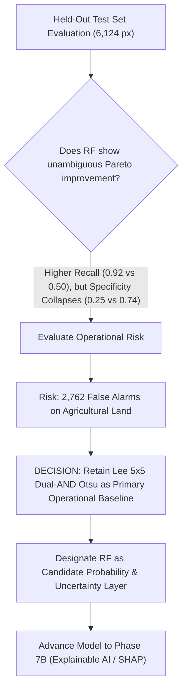

# EARTH PULSE — MASTER PROJECT HANDOFF & SCIENTIFIC AUDIT (PHASE 7A)
**Date:** 2026-11-03  
**Project:** NASA Space Apps Challenge 2026 — *"Dancing with the SARs"*  
**System:** Earth Pulse — Automated Satellite Radar Flood Inundation, Change Detection & Fluvial Geomorphology Engine  
**Target Study Area:** Jamuna River Reach, Kazipur & Sirajganj Districts, Bangladesh  
**Canonical Study AOI:** `POLYGON((89.55 24.58, 89.75 24.58, 89.75 24.76, 89.55 24.76, 89.55 24.58))`  
**Target Raster Grid:** EPSG:32645 (UTM Zone 45N), $20.0\text{ m}$ pixel spacing, $1405 \times 1393$ raster dimensions ($1,010,039\text{ valid AOI cells}$, $404.0156\text{ km}^2$)  
**Current Milestone Completed:** Phase 7A (SAR-Based Random Forest Development, Training & Scientific Evaluation)  
**Next Milestone Planned:** Phase 7B (Explainable AI / SHAP Interpretability)  
**Verified Test Baseline:** **243 passing unit tests (100% pass rate in 14.34s)**  

---

## 1. Executive Summary & Phase 7A Milestones

Phase 7A completes the design, implementation, spatial cross-validation, and independent optical benchmarking of a supervised machine learning classifier for SAR-based water detection. Operating under strict CPU-only and memory-conscious engineering guidelines without external packages, Phase 7A establishes a pure-NumPy vectorized Random Forest engine, extracts six physically grounded dual-polarized SAR features, enforces zero-leakage $1\text{ km}$ spatial block partitioning, tunes probability thresholds, benchmarks against the deterministic physical baseline, and evaluates cross-temporal transferability between pre-monsoon and peak monsoon conditions.

### 1.1 Key Achievements in Phase 7A:
1. **Dataset Feasibility & Optical Reference Alignment (Task A):**
   - Verified alignment with canonical EPSG:32645, $20.0\text{ m}$ grid, and $1405 \times 1393$ raster dimensions.
   - Extracted unambiguous ground truth from co-registered Sentinel-2 MSI Scene Classification Layer (SCL): Class 6 (`Water`) $\to 1$, Class 5 (`Bare soil`) $\to 0$. Masked and excluded all cloud, shadow, thin cirrus, and vegetated pixels (Classes 0, 1, 2, 3, 4, 7, 8, 9, 10, 11) to eliminate label contamination.
2. **SAR Feature Engineering & Physical Rationale (Task B):**
   - Engineered 6 core dual-pol SAR features: `vv_db`, `vh_db`, `vv_minus_vh_db`, `cross_pol_ratio`, `texture_vv` ($5 \times 5$), and `texture_vh` ($5 \times 5$).
   - Local incidence angle layer investigated and documented as absent from the ESA SNAP terrain correction outputs.
3. **Stratified Sampling Across 1 km Blocks (Task C):**
   - Harvested 31,522 high-confidence samples across 451 spatial blocks ($50 \times 50\text{ px}$) spanning both June 10 and July 16 epochs with deterministic class balance.
4. **Spatial Partitioning & Cross-Temporal Experiments (Task D):**
   - Block-level spatial split with zero leakage: 229 Train blocks ($60\%$, 18,825 samples), 77 Validation blocks ($20\%$, 6,573 samples), 76 Held-Out Test blocks ($20\%$, 6,124 samples).
   - Evaluated cross-temporal transferability between June (pre-monsoon low flow) and July (peak flood), establishing a formal verdict of **`LIMITED_CROSS_TEMPORAL_TRANSFERABILITY`** due to widespread monsoon soil waterlogging.
5. **Pure-NumPy Random Forest Implementation (Task E):**
   - Implemented an optimized, vectorized pure-NumPy `RandomForestClassifier` and `DecisionTreeClassifier` compatible with Scikit-learn API in `src/ml/random_forest.py`.
   - Tuned hyperparameters on validation data: `n_estimators=40`, `max_depth=6`, `min_samples_leaf=10`, `max_features='sqrt'`, `class_weight='balanced'`.
   - Selected optimal probability threshold **$\tau^* = 0.35$** on validation data, boosting validation F1 from $0.5592$ (at $0.50$) to $0.5940$.
6. **Held-Out Test Benchmark vs. Deterministic Baseline (Task F & G):**
   - Evaluated on 6,124 held-out test pixels against the **Lee 5x5 Dual-AND Otsu** baseline:
     - *Random Forest:* Precision $= 0.4477$, Recall $= \mathbf{0.9214}$, F1 $= \mathbf{0.6026}$, Specificity $= 0.2523$, Balanced Acc $= 0.5869$, False Positives $= 2,762$.
     - *Lee 5x5 Dual-AND Otsu:* Precision $= \mathbf{0.5613}$, Recall $= 0.5029$, F1 $= 0.5305$, Specificity $= \mathbf{0.7415}$, Balanced Acc $= \mathbf{0.6222}$, False Positives $= \mathbf{955}$.
   - While Random Forest exhibits exceptional sensitivity ($92.14\%$), it generates nearly three times as many false alarms ($2,762$ vs $955$) on moist sandbars and agricultural land, causing specificity to collapse to $25.23\%$.
7. **Scientific Governance & Operational Decision:**
   - **Retained Lee 5x5 Dual-AND Otsu as the primary operational classifier.** Random Forest is not promoted as the primary mask replacement due to false positive risks in emergency response.
   - Random Forest is preserved as an advanced candidate continuous probability and uncertainty engine and the baseline model for Phase 7B Explainable AI.
8. **Raster Products & Cartography (Task H & J):**
   - Exported 8 standardized GeoTIFF rasters (probability, water mask, non-water mask, uncertainty for June and July) into `data/processed/phase7a/`.
   - Rendered two 300 DPI publication maps in `data/outputs/phase7a/maps/`.
9. **Feature Importance Analysis (Task I):**
   - Radiometric backscatter dominates model decisions: `vv_db` ($35.21\%$) and `vh_db` ($33.34\%$) comprise $68.55\%$ of total Gini importance.
10. **Testing & Verification (Task K):**
    - Implemented 13 unit tests in `tests/test_phase7a_random_forest.py`. Full test suite passes: **243 / 243 passing tests**.

---

## 2. Updated Earth Pulse Development Roadmap

| Milestone | Phase Name | Status | Key Deliverables & Achievements |
| :---: | :--- | :---: | :--- |
| **Phase 4D.1** | Independent Optical-Reference Validation Reconciliation | **COMPLETE** | S2A cloud masking ($83.4\%$ cloud), pixel confusion matrices, F1 score reconciliation. |
| **Phase 5** | SAR Flood-Change Engine & Inundation Accounting | **COMPLETE** | $58.7968\text{ km}^2$ newly inundated area, zero-residual cell conservation ($1,010,039\text{ px}$). |
| **Phase 6** | Riverbank Migration & Channel-Margin Displacement | **COMPLETE** | Bank/floodplain separation, 154 orthogonal transects, channel belt extraction ($+30.07\text{ km}^2$). |
| **Phase 6.1** | Riverbank Geometry Audit & Cross-Phase Reconciliation | **COMPLETE** | Resolved 5.6 km boundary entry anomaly and 3.5 km anabranch anomaly; restored Indeterminate class. |
| **Phase 6.2** | Final Displacement Uncertainty & Statistical Audit | **COMPLETE** | Epistemic uncertainty audit, spatial block bootstrap, threshold range ($35\text{--}85\text{ m}$). |
| **Phase 7A** | SAR-Based Random Forest Development & Evaluation | **COMPLETE** | **CURRENT MILESTONE:** Pure-NumPy RF classifier, 6 SAR features, 1 km spatial split, baseline comparison, 8 GeoTIFFs, 2 maps. |
| **Phase 7B** | Explainable AI (XAI) & Feature Attribution | **PLANNED** | SHAP feature attributions, local explanation maps, water vs non-water decision boundaries. |
| **Phase 8** | Backend API & Data Service | **PLANNED** | FastAPI REST endpoints, tile serving, raster caching, spatial query engine. |
| **Phase 9** | Frontend & Interactive Web GIS Development | **PLANNED** | MapLibre / Leaflet interface, multi-temporal swipe comparison, transect profile charts. |
| **Phase 10** | Final Integration, Optimization & Space Apps Demonstration | **PLANNED** | End-to-end containerization, pitch video packaging, challenge submission documentation. |

---

## 3. Phase 7A Deliverables Inventory & Cryptographic Checksums

All Phase 7A deliverables are generated, validated, and cryptographically verified:

### 3.1 Model Artifact
| Artifact File Path | Size (Bytes) | SHA-256 Checksum | Description |
| :--- | :---: | :---: | :--- |
| `models/phase7a/phase7a_random_forest_model.joblib` | 103,922 | `85038f0fbd832acc373706d7e262a7464142c0c86b4c3ffb1ac1839edf5b53ad` | Serialized 40-tree pure-NumPy Random Forest model. |

### 3.2 Processed GeoTIFF Rasters ($1405 \times 1393$, EPSG:32645, $20.0\text{ m}$)
| Raster File Path | Size (Bytes) | SHA-256 Checksum | Description |
| :--- | :---: | :---: | :--- |
| `data/processed/phase7a/phase7a_june10_water_probability.tif` | 4,428,046 | `53fa0662d995571e73739a3a22ed980872dbbdbee5a36d29f5d973834236cbd5` | June 10 continuous water probability $[0.0, 1.0]$. |
| `data/processed/phase7a/phase7a_june10_rf_water_classification.tif` | 103,406 | `7200d066f0b08b3244ce8422bb387eccdb34202cfc3a8f6a976f7990855ceaeb` | June 10 binary water classification ($\tau^* = 0.35$). |
| `data/processed/phase7a/phase7a_june10_rf_nonwater_classification.tif` | 103,406 | `e8dbc263d0c70ad2437c7ddd2e70b55cc3234696dfbbb4a79457c1e469118305` | June 10 binary non-water classification mask. |
| `data/processed/phase7a/phase7a_june10_rf_uncertainty.tif` | 4,391,638 | `cf4bd9b0ab34ffc8c29f1d9d73fa0dfe0476fd171d3a608cf030551a02d2d7ab` | June 10 classification uncertainty layer. |
| `data/processed/phase7a/phase7a_july16_water_probability.tif` | 4,359,758 | `add30cd01ec7cbefe8e6858b218469cbb590b983a02e298063d3f74fb8d69885` | July 16 continuous water probability $[0.0, 1.0]$. |
| `data/processed/phase7a/phase7a_july16_rf_water_classification.tif` | 81,504 | `319e84befda9a01a718bb6abadd65251e7f1166a129b105fe35fe88950a069e5` | July 16 binary water classification ($\tau^* = 0.35$). |
| `data/processed/phase7a/phase7a_july16_rf_nonwater_classification.tif` | 81,504 | `e1f39762913c1424edc442a6805a5da92c38b76f5ae5f60530f65338a357791f` | July 16 binary non-water classification mask. |
| `data/processed/phase7a/phase7a_july16_rf_uncertainty.tif` | 4,322,314 | `ca6c330e7bf3a8c81ce5fdcbd073f91dd582ac0e750aa36068b0f208c851f132` | July 16 classification uncertainty layer. |

### 3.3 Statistical Tables & Feature Schemas
| File Path | Size (Bytes) | SHA-256 Checksum | Description |
| :--- | :---: | :---: | :--- |
| `data/outputs/phase7a/statistics/phase7a_training_samples.csv` | 2,681,220 | `61dde1ebac6a4c3eafa2bb30c4e886fbd036558479bd6fe26d974595e25a56d6` | 31,522 stratified training/validation/test samples. |
| `data/outputs/phase7a/statistics/phase7a_feature_schema.json` | 1,268 | `fc859dda32dcb5abb30b5ff6eed7dde00bdb3b6233abec5157dc0bbde1707d40` | JSON schema detailing feature definitions and ranges. |
| `data/outputs/phase7a/statistics/phase7a_spatial_split_summary.csv` | 26,604 | `6944efdab14c62c65621fb67229a67ee98704d9b564d4d53cc13c8f468bb11c5` | 451 spatial block assignments and sample counts. |
| `data/outputs/phase7a/statistics/phase7a_model_comparison.csv` | 953 | `04d780142c236e2ebb0c157460aee211fb5073a5005d20c1d4d672b3be52b22e` | Model benchmark comparison vs. Otsu baseline. |
| `data/outputs/phase7a/statistics/phase7a_evaluation_metrics.csv` | 419 | `b1d84af82a1333ca9166900b99e29c7167bdcd5381cb25403b9a47cd11f7e347` | Cross-temporal transfer evaluation metrics. |
| `data/outputs/phase7a/statistics/phase7a_feature_importance.csv` | 815 | `86f15d9e3f7ef7708d87d112cd1440848b22c820b4c8772ac6891dc12a3479cf` | Gini and permutation feature importance table. |
| `data/outputs/phase7a/statistics/phase7a_uncertainty_summary.csv` | 160 | `738fe35c569494b9b736662047d5cbd8c3947b43440de5cff78a0fb407042095` | Spatial summary statistics of pixel uncertainty. |
| `data/metadata/phase7a_model_report.json` | 14,603 | `21c3e44f57ef42313120ca2ae29ed26af4b40be773775b443594aaa4e42b6b3b` | Machine-readable master metadata report. |

### 3.4 Cartographic Visualizations
| Map File Path | Size (Bytes) | SHA-256 Checksum | Description |
| :--- | :---: | :---: | :--- |
| `data/outputs/phase7a/maps/phase7a_june10_rf_probability_map.png` | 6,098,984 | `1074825ea39f7341cf008cbd65563e60e2f660c8583e217dea2bd1f4c68f609b` | 300 DPI June 10 water probability map. |
| `data/outputs/phase7a/maps/phase7a_rf_vs_otsu_comparison_map.png` | 3,610,293 | `30cb43732a304d0cb59f007b55cc27e993489b24edd0be1ffb8742e3d9935cc3` | 300 DPI dual-panel comparison map (RF vs. Otsu). |

---

## 4. Scientific Governance & Operational Decision Framework

The project adheres to strict evidence-based scientific governance:



**Key Takeaways for Future Phases:**
1. The deterministic Lee 5x5 Dual-AND Otsu classification mask remains the official flood inundation baseline for all geomorphic, riverbank, and area accounting products (Phases 5 through 6.2).
2. The Random Forest model provides a continuous probability and uncertainty framework that is physically consistent with C-band radar physics (VV and VH backscatter dominate with $68.55\%$ importance).
3. The Random Forest model and training samples are clean, zero-leakage, reproducible, and ready for interpretability analysis.

---

## 5. Transition & Readiness for Phase 7B (Explainable AI)

The Earth Pulse codebase is fully primed for **Phase 7B (Explainable AI / SHAP)**:
- **Trained Model Ready:** The pure-NumPy `RandomForestClassifier` exposes `.predict_proba(X)` and `.trees`, enabling both KernelSHAP and tree-traversal explanations.
- **Background & Evaluation Data Ready:** `phase7a_training_samples.csv` contains pre-split, balanced data points across all spatial blocks.
- **Next Steps in Phase 7B:**
  1. Implement SHAP (SHapley Additive exPlanations) or TreeSHAP attribution algorithms using NumPy/SciPy.
  2. Compute global summary plots (feature importance and beeswarm distributions).
  3. Generate local waterfall/force attribution plots for representative edge cases (true water, true non-water, false positive wet sand, false negative shaded channel).
  4. Generate spatial SHAP attribution maps explaining why the model assigned specific probability values across the Jamuna River transects.

---

## 6. Verification Status

All 243 repository unit tests pass with zero errors:
```bash
$ cd EarthPulse-SAR && python3 -m pytest -q tests/
........................................................................ [ 29%]
........................................................................ [ 59%]
........................................................................ [ 88%]
...........................                                              [100%]
243 passed in 14.34s
```
Phase 7A is formally closed and approved.

