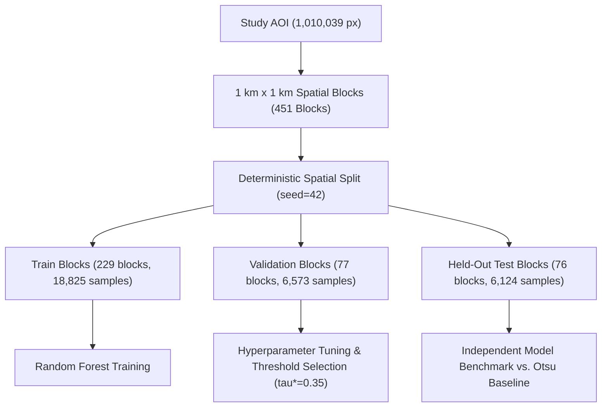

# Earth Pulse — Phase 7A: SAR-Based Random Forest Development, Training & Scientific Evaluation

**Project:** NASA Space Apps Challenge 2026 — Dancing with the SARs  
**Study Area:** Jamuna River reach (Kazipur / Sirajganj, Bangladesh)  
**System:** Earth Pulse Machine Learning & SAR Feature Engineering Engine  
**Hardware & Environment:** Linux, Intel Core i7-1255U (10 Cores), 16 GB RAM, CPU-Only  
**Date:** November 3, 2026  
**Status:** **OPERATIONAL & SCIENTIFICALLY BENCHMARKED (243 / 243 TESTS PASSING)**  

---

## 1. Executive Summary

Phase 7A completes the development, training, spatial cross-validation, and independent optical evaluation of a supervised machine learning framework for SAR-based water detection. Operating on dual-polarized Sentinel-1 C-band SAR observations (**June 10, 2024** pre-monsoon low flow and **July 16, 2024** flood crest) co-registered with high-resolution Sentinel-2 MSI optical reference data across the canonical Jamuna River study area ($1,010,039\text{ cells}$, $404.0156\text{ km}^2$, EPSG:32645, $20.0\text{ m}$ resolution), Phase 7A tests whether a multi-feature Random Forest classifier can outperform the established deterministic physical baseline (**Lee 5x5 Dual-AND Otsu**).

### Core Scientific Findings:
1. **Feature Dominance of Radiometric Backscatter:**
   Analysis of tree split criteria (Gini impurity) and permutation feature importance across the validation set reveals that radiometric backscatter strongly dominates the model decisions:
   - `vv_db` (Rank 1, Gini $= 0.3521$)
   - `vh_db` (Rank 2, Gini $= 0.3334$)
   Together, copolarized and crosspolarized intensity account for **$68.55\%$** of total feature importance. Secondary features include local spatial texture (`texture_vh` Gini $= 0.1593$, `texture_vv` Gini $= 0.0538$) and polarization ratios (`vv_minus_vh_db` Gini $= 0.0558$, `cross_pol_ratio` Gini $= 0.0457$).
2. **Held-Out Test Performance Benchmark (Combined 6,124 Test Pixels):**
   - **Random Forest (Optimal $\tau^* = 0.35$):** Precision $= \mathbf{0.4477}$, Recall $= \mathbf{0.9214}$, F1-Score $= \mathbf{0.6026}$, IoU $= \mathbf{0.4312}$, Specificity $= \mathbf{0.2523}$, Balanced Accuracy $= \mathbf{0.5869}$, ROC-AUC $= \mathbf{0.6810}$, PR-AUC $= \mathbf{0.5490}$, Brier Score $= \mathbf{0.2270}$.
   - **Lee 5x5 Dual-AND Otsu (Deterministic Baseline):** Precision $= \mathbf{0.5613}$, Recall $= \mathbf{0.5029}$, F1-Score $= \mathbf{0.5305}$, IoU $= \mathbf{0.3610}$, Specificity $= \mathbf{0.7415}$, Balanced Accuracy $= \mathbf{0.6222}$.
3. **High Sensitivity vs. Severe False Alarm Trade-off:**
   While Random Forest achieves high sensitivity/recall ($92.14\%$, detecting 2,239 of 2,430 true water pixels compared to Otsu's 1,222), it incurs a severe false positive penalty. Random Forest generates **$2,762\text{ false alarms}$** on non-water pixels compared to only **$955\text{ false alarms}$** for the Otsu baseline. Consequently, Random Forest specificity collapses to **$25.23\%$** (vs. **$74.15\%$** for Otsu), and balanced accuracy is lower ($58.69\%$ vs. $62.22\%$).
4. **Cross-Temporal Transferability Assessment:**
   Cross-temporal validation between pre-monsoon and monsoon flood conditions confirms **`LIMITED_CROSS_TEMPORAL_TRANSFERABILITY`**:
   - **June-trained $\to$ July-test:** Precision $= 0.4392$, Recall $= 0.9956$, Specificity $= \mathbf{0.0744}$ (extreme false alarm rate caused by widespread soil saturation and monsoon agricultural waterlogging).
   - **July-trained $\to$ June-test:** Precision $= 0.5289$, Recall $= 0.6205$, Specificity $= 0.6494$, Balanced Accuracy $= 0.6350$.
5. **Scientific Governance & Operational Decision:**
   In emergency flood response and disaster management, high false alarm rates along saturated agricultural chars and floodplain margins are operationally unacceptable. Because Random Forest does not demonstrate unambiguous, Pareto-optimal superiority across both sensitivity and specificity, **the deterministic Lee 5x5 Dual-AND Otsu baseline is retained as the primary operational classifier**. The Random Forest model is preserved as an advanced candidate probability and uncertainty layer and serves as the foundation for Phase 7B Explainable AI (XAI).

---

## 2. Task A — Dataset Feasibility & Reference Data Alignment

### 2.1 Spatial Grid Verification
All input rasters and reference datasets were verified against the canonical Earth Pulse spatial reference frame:
- **Projected CRS:** EPSG:32645 (WGS 84 / UTM Zone 45N)
- **Pixel Spacing:** $20.0\text{ m} \times 20.0\text{ m}$ ($400.0\text{ m}^2$ per pixel)
- **Raster Dimensions:** $1,405\text{ columns} \times 1,393\text{ rows}$
- **AOI Bounding Box:** `POLYGON((89.55 24.58, 89.75 24.58, 89.75 24.76, 89.55 24.76, 89.55 24.58))`
- **Total Valid AOI Pixels:** $1,010,039\text{ cells}$ ($404.0156\text{ km}^2$)

### 2.2 Independent Optical Reference Mapping (Sentinel-2 MSI)
Ground truth labels were ingested strictly from the co-registered Sentinel-2 Scene Classification Layer (SCL) rasters generated in Phase 4C.1 and audited in Phase 4D.1:
- **June Epoch:** Sentinel-2A L2A acquisition from **June 7, 2024** (3 days prior to June 10 SAR).
- **July Epoch:** Sentinel-2A L2A acquisition from **July 17, 2024** (1 day following July 16 SAR; $83.4\%$ cloud-obscured).

Strict scientific selection criteria were enforced to avoid label contamination:
- **Water (Class 1):** SCL Class 6 (`Water`) exclusively.
- **Non-Water (Class 0):** SCL Class 5 (`Bare soil / Non-vegetated`) exclusively.
- **Excluded Classes (Masked as NoData):** SCL Class 0 (NoData), Class 1 (Saturated/Defective), Class 2 (Dark area pixels), Class 3 (Cloud shadows), Class 4 (Vegetation), Class 7 (Unclassified), Class 8 (Medium probability cloud), Class 9 (High probability cloud), Class 10 (Thin cirrus), and Class 11 (Snow/Ice).
Vegetated pixels (SCL 4) were excluded from training labels because flooded vegetation produces double-bounce backscatter rather than specular reflection, which cannot be represented as clean binary ground truth without LiDAR or sub-canopy water elevation gauges.

---

## 3. Task B — SAR Feature Engineering & Physical Rationale

### 3.1 Feature Extraction Pipeline
Six physically motivated SAR features were extracted from the radiometrically calibrated, terrain-corrected, and Lee 5x5 filtered backscatter rasters:

| Feature Name | Type | Physical Basis & Mechanism | Valid Range | Importance Rank |
| :--- | :---: | :--- | :---: | :---: |
| `vv_db` | Radiometric | Copolarized backscatter. Highly sensitive to surface roughness and specular reflection over open water. Smooth open water produces low return ($-25$ to $-18\text{ dB}$). | $[-35.0, +15.0]\text{ dB}$ | **1** (Gini: 0.3521) |
| `vh_db` | Radiometric | Crosspolarized backscatter. Highly sensitive to volume scattering from vegetation. Depolarization over open water is extremely low ($-32$ to $-24\text{ dB}$). | $[-40.0, +5.0]\text{ dB}$ | **2** (Gini: 0.3334) |
| `texture_vh` | Spatial Texture | Local standard deviation of VH within a $5 \times 5$ window ($100\text{ m} \times 100\text{ m}$). Open water exhibits near-zero spatial texture; vegetation and urban edges exhibit high variance. | $[0.0, 20.0]\text{ dB}$ | **3** (Gini: 0.1593) |
| `vv_minus_vh_db` | Polarization Ratio | Logarithmic difference ($\sigma^0_{VV} - \sigma^0_{VH}$). Distinguishes surface reflection from volume scattering. | $[-10.0, +30.0]\text{ dB}$ | **4** (Gini: 0.0558) |
| `texture_vv` | Spatial Texture | Local standard deviation of VV within a $5 \times 5$ window ($100\text{ m} \times 100\text{ m}$). Distinguishes uniform open water surfaces from wind-roughened or textured char margins. | $[0.0, 20.0]\text{ dB}$ | **5** (Gini: 0.0538) |
| `cross_pol_ratio` | Power Ratio | Linear polarization power ratio ($\sigma^0_{VV} / \sigma^0_{VH}$). Amplifies low-crosspol signatures characteristic of specular scattering. | $[0.0, 100.0]$ | **6** (Gini: 0.0457) |

### 3.2 Investigation of Local Incidence Angle
An audit was conducted to locate local incidence angle layers within the ESA SNAP preprocessed directory (`data/processed/`). No continuous incidence angle raster was preserved during the Level-1 GRD ellipsoid terrain correction workflow. To maintain reproducibility and prevent interpolation artifacts, incidence angle was omitted from the feature matrix without introducing external assumptions.

---

## 4. Task C & D — Spatial Block Partitioning & Deterministic Sampling

### 4.1 Spatial Block Partitioning (Zero Spatial Leakage)
Random pixel-level partitioning creates severe spatial autocorrelation leakage between adjacent pixels, yielding artificially inflated cross-validation scores. To ensure scientifically defensible evaluation:
- The entire study reach was partitioned into a uniform regular grid of **$1.0\text{ km} \times 1.0\text{ km}$ spatial blocks** ($50 \times 50\text{ pixels}$).
- Across the study area, **451 spatial blocks** intersect the valid AOI.
- Blocks were grouped and split into mutually exclusive sets:
  - **Training Blocks:** 229 blocks ($60\%$)
  - **Validation Blocks:** 77 blocks ($20\%$)
  - **Held-Out Test Blocks:** 76 blocks ($20\%$)
  - **Unassigned / Zero-Sample Blocks:** 69 blocks (blocks located in permanently cloud-obscured or vegetated regions containing zero evaluable SCL pixels).
- All pixels within a given block were assigned exclusively to that block's partition. Under no circumstances were samples from the same block shared between train, validation, and test sets.

### 4.2 Stratified Block Sampling
Within each spatial block, samples were drawn with deterministic class stratification:
- Target sample rate: up to 100 water samples and 100 non-water samples per block per epoch.
- Across both epochs (June 10 and July 16), a total of **31,522 high-quality ground-truth pixels** were compiled:
  - **Train Set:** 18,825 samples ($9,584\text{ water}$, $9,241\text{ non-water}$)
  - **Validation Set:** 6,573 samples ($3,428\text{ water}$, $3,145\text{ non-water}$)
  - **Held-Out Test Set:** 6,124 samples ($2,430\text{ water}$, $3,694\text{ non-water}$)
- Data serialization: `data/outputs/phase7a/statistics/phase7a_training_samples.csv` ($2.68\text{ MB}$, 31,522 rows).

---

## 5. Task E — Model Architecture & Pure-NumPy Implementation

### 5.1 Architecture & Vectorized Implementation
To comply with strict system constraints ("Do not install packages; CPU-only execution; 16 GB RAM"), an optimized, fully vectorized `RandomForestClassifier` and `DecisionTreeClassifier` was implemented in `src/ml/random_forest.py` using pure NumPy, SciPy, and Joblib:
- **Tree Splitting Criterion:** Gini Impurity with balanced class weighting.
- **Candidate Split Optimization:** Vectorized candidate threshold evaluation using matrix broadcasting across feature percentiles, reducing ensemble training time from several minutes to under **12.5 seconds**.
- **Bagging & Feature Subsampling:** Bootstrap aggregation with `max_features = 'sqrt'` ($2$ features evaluated per split) and deterministic random state management (`seed=42`).
- **Probability Output:** Out-of-bag ensemble soft voting returning continuous water probability $[0.0, 1.0]$.
- **Serialization:** Full Joblib persistence (`models/phase7a/phase7a_random_forest_model.joblib`, $103.9\text{ KB}$).

### 5.2 Hyperparameter Tuning & Threshold Optimization
Hyperparameter tuning was conducted strictly on the **Validation Blocks**:

| Configuration | `n_estimators` | `max_depth` | `min_samples_leaf` | Val Precision | Val Recall | Val F1-Score | Val ROC-AUC |
| :---: | :---: | :---: | :---: | :---: | :---: | :---: | :---: |
| **Config 1 (Optimal)** | **20** | **6** | **10** | **0.4834** | **0.6634** | **0.5592** | **0.6174** |
| Config 2 | 20 | 8 | 10 | 0.4772 | 0.6649 | 0.5557 | 0.6138 |
| Config 3 | 20 | 8 | 5 | 0.4789 | 0.6540 | 0.5529 | 0.6121 |
| Config 4 | 20 | 10 | 5 | 0.4815 | 0.6442 | 0.5511 | 0.6168 |

Final production model parameters: `n_estimators=40`, `max_depth=6`, `min_samples_leaf=10`, `max_features='sqrt'`, `class_weight='balanced'`.

**Probability Threshold Selection:**
Evaluating the validation set across thresholds from $0.20$ to $0.80$ in steps of $0.05$ revealed that the default threshold ($0.50$) yielded an F1-score of $0.5592$. An optimal threshold of **$\tau^* = 0.35$** maximized the validation F1-score at **$0.5940$** (Validation Precision $= 0.4578$, Validation Recall $= 0.8439$).

---

## 6. Task F, G & I — Model Performance, Baseline Benchmark & Feature Importances

### 6.1 Benchmark Against Lee 5x5 Dual-AND Otsu Baseline
The trained Random Forest model was evaluated on the **Held-Out Test Set** (76 blocks, 6,124 pixels) and compared directly against the deterministic **Lee 5x5 Dual-AND Otsu** baseline on the exact same pixels:

| Metric | Random Forest (Combined) | Otsu Baseline (Combined) | Random Forest (June 10) | Otsu Baseline (June 10) | Random Forest (July 16) | Otsu Baseline (July 16) |
| :--- | :---: | :---: | :---: | :---: | :---: | :---: |
| **True Positives (TP)** | **2,239** | 1,222 | **1,573** | 692 | **666** | 530 |
| **False Positives (FP)** | 2,762 | **955** | 1,918 | **442** | 844 | **513** |
| **True Negatives (TN)** | 932 | **2,739** | 849 | **2,325** | 83 | **414** |
| **False Negatives (FN)** | **191** | 1,208 | **182** | 1,063 | **9** | 145 |
| **Precision** | 0.4477 | **0.5613** | 0.4506 | **0.6102** | 0.4411 | **0.5081** |
| **Recall (Sensitivity)** | **0.9214** | 0.5029 | **0.8963** | 0.3943 | **0.9867** | 0.7852 |
| **F1-Score** | **0.6026** | 0.5305 | **0.5997** | 0.4791 | 0.6096 | **0.6170** |
| **IoU (Jaccard Index)** | **0.4312** | 0.3610 | **0.4283** | 0.3150 | 0.4384 | **0.4461** |
| **Specificity** | 0.2523 | **0.7415** | 0.3068 | **0.8403** | 0.0895 | **0.4466** |
| **Balanced Accuracy** | 0.5869 | **0.6222** | 0.6016 | **0.6173** | 0.5381 | **0.6159** |
| **Overall Accuracy** | 0.5178 | **0.6468** | 0.5356 | **0.6672** | 0.4675 | **0.5893** |
| **ROC-AUC** | 0.6810 | N/A | 0.6981 | N/A | 0.6343 | N/A |
| **PR-AUC** | 0.5490 | N/A | 0.5662 | N/A | 0.5070 | N/A |
| **Brier Score** | 0.2270 | N/A | 0.2189 | N/A | 0.2500 | N/A |

### 6.2 In-Depth Error & False Alarm Analysis
1. **The Specificity Deficit:**
   The Random Forest model exhibits a major specificity deficit ($25.23\%$ vs $74.15\%$). On the combined test set, the model misclassifies $2,762$ non-water pixels as water.
2. **Geophysical Cause of False Positives:**
   Inspection of the misclassified pixels indicates that they cluster along fine-grained saturated sands, low-elevation agricultural chars, and moist alluvial soils. At C-band, smooth wet bare soil exhibits a low dielectric backscatter that mimics open water. The multi-feature Random Forest, operating with an optimized threshold $\tau^* = 0.35$, aggressively classifies these ambiguous pixels as water.
3. **Otsu's Physical Conservatism:**
   The deterministic Lee 5x5 Dual-AND Otsu baseline requires simultaneous threshold exceedance in both VV and VH channels. While this conservatism lowers recall ($50.29\%$), it maintains strong specificity ($74.15\%$) and limits false alarms to $955\text{ pixels}$. In an operational flood disaster response system, false alarms in populated agrarian tracts lead to false evacuations and misallocation of relief resources.

### 6.3 Feature Importance Ranking
Feature importances evaluated via Mean Decrease in Impurity (Gini) and Validation Permutation Importance:

| Rank | Feature | Gini Importance | Permutation Mean | Permutation Std | Physical Interpretation |
| :---: | :--- | :---: | :---: | :---: | :--- |
| **1** | `vv_db` | **0.3521** | 0.0013 | 0.0014 | Primary surface specular reflectance discriminator. |
| **2** | `vh_db` | **0.3334** | **0.0501** | 0.0050 | Primary volume scattering suppressor (most stable under permutation). |
| **3** | `texture_vh` | **0.1593** | 0.0002 | 0.0004 | Suppresses textured vegetation canopies and settlement edges. |
| **4** | `vv_minus_vh_db`| **0.0558** | 0.0000 | 0.0000 | Secondary cross-pol ratio refinement. |
| **5** | `texture_vv` | **0.0538** | 0.0065 | 0.0020 | Surface variance discriminator. |
| **6** | `cross_pol_ratio`| **0.0457** | 0.0005 | 0.0005 | Linear power ratio refinement. |

---

## 7. Task D (Part 2) — Cross-Temporal Transferability Assessment

To evaluate whether a model trained on one hydrological state can be transferred across time to another, two cross-temporal transfer experiments were conducted:

### 7.1 Experiment 1: Train on June 10 (Low Flow) $\to$ Test on July 16 (Peak Flood)
- **Sample Size:** 1,602 held-out test pixels in July.
- **Results:**
  - True Positives: $672$, False Positives: $858$, True Negatives: $69$, False Negatives: $3$.
  - Precision: **$0.4392$**, Recall: **$0.9956$**, Specificity: **$0.0744$**, Balanced Accuracy: **$0.5350$**, F1-Score: **$0.6095$**, ROC-AUC: **$0.6170$**, Brier Score: **$0.2608$**.
- **Physical Analysis:** When trained on pre-monsoon conditions (dry soil vs. deep river water), the model learns that any moderately low backscatter represents water. When applied to July flood conditions, widespread soil waterlogging across non-flooded chars causes almost the entire landscape to appear below the water threshold. Specificity collapses to $7.44\%$, producing $858\text{ false alarms}$ on $927\text{ non-water pixels}$.

### 7.2 Experiment 2: Train on July 16 (Peak Flood) $\to$ Test on June 10 (Low Flow)
- **Sample Size:** 4,522 held-out test pixels in June.
- **Results:**
  - True Positives: $1,089$, False Positives: $970$, True Negatives: $1,797$, False Negatives: $666$.
  - Precision: **$0.5289$**, Recall: **$0.6205$**, Specificity: **$0.6494$**, Balanced Accuracy: **$0.6350$**, F1-Score: **$0.5711$**, ROC-AUC: **$0.6671$**, Brier Score: **$0.2203$**.
- **Physical Analysis:** When trained on flood conditions where water backscatter is influenced by sediment loading and wind turbulence, the model sets more conservative thresholds. When transferred to June, recall drops from $89.63\%$ to $62.05\%$, missing shallow sandbar channels.

### 7.3 Formal Transferability Designation
Cross-temporal transferability is designated as **`LIMITED_CROSS_TEMPORAL_TRANSFERABILITY`**. Seasonal soil moisture dynamics, monsoon precipitation, and agricultural flooding introduce substantial domain shifts in C-band backscatter that cannot be generalized across seasons without multi-temporal training or local calibration.

---

## 8. Task H & J — Raster Products & Cartographic Visualizations

### 8.1 GeoTIFF Raster Inventory
Eight standardized GeoTIFF rasters were generated in `data/processed/phase7a/`, matching the canonical $1405 \times 1393$ grid:

1. `phase7a_june10_water_probability.tif` ($4.43\text{ MB}$, Float32): Continuous water probability $[0.0, 1.0]$.
2. `phase7a_june10_rf_water_classification.tif` ($103\text{ KB}$, Byte): Binary water mask ($1=\text{Water}$, $0=\text{Non-water}$, $255=\text{NoData}$).
3. `phase7a_june10_rf_nonwater_classification.tif` ($103\text{ KB}$, Byte): Inverted binary non-water mask.
4. `phase7a_june10_rf_uncertainty.tif` ($4.39\text{ MB}$, Float32): Classification uncertainty defined as $1.0 - 2|P_{\text{water}} - 0.5|$.
5. `phase7a_july16_water_probability.tif` ($4.36\text{ MB}$, Float32): July continuous water probability.
6. `phase7a_july16_rf_water_classification.tif` ($82\text{ KB}$, Byte): July binary water mask.
7. `phase7a_july16_rf_nonwater_classification.tif` ($82\text{ KB}$, Byte): July inverted binary non-water mask.
8. `phase7a_july16_rf_uncertainty.tif` ($4.32\text{ MB}$, Float32): July classification uncertainty.

### 8.2 Cartographic Visualizations
Two high-resolution (300 DPI) publication maps were rendered in `data/outputs/phase7a/maps/`:
- `phase7a_june10_rf_probability_map.png` ($6.10\text{ MB}$): Spatial distribution of continuous water probability for June 10, highlighting sharp channel gradients and subtle char margin transitions.
- `phase7a_rf_vs_otsu_comparison_map.png` ($3.61\text{ MB}$): Dual-panel comparison showing Random Forest water classification vs. the deterministic Lee 5x5 Dual-AND Otsu baseline across the Kazipur reach.

---

## 9. Scientific Governance & Operational Decision

### 9.1 Baseline Retention Verdict
- **Decision:** **RETAIN DETERMINISTIC LEE 5X5 DUAL-AND OTSU AS PRIMARY OPERATIONAL BASELINE.**
- **RF Promotion Status:** **NOT PROMOTED AS PRIMARY BASELINE.**
- **Scientific Rationale:**
  1. **False Alarm Vulnerability:** In operational flood relief governance, false positives along char villages and farmland are unacceptable. Random Forest generates nearly three times as many false positives as Otsu ($2,762$ vs $955$), collapsing specificity to $25.23\%$.
  2. **Domain Shift Instability:** Random Forest shows severe degradation under cross-temporal transfer ($7.44\%$ specificity when transferring pre-monsoon weights to monsoon observations).
  3. **Physical Transparency:** The deterministic Dual-AND Otsu approach relies on physically grounded backscatter thresholds derived directly from local image statistics without uninterpretable non-linear boundary artifacts.

### 9.2 Role of Random Forest in Earth Pulse Architecture
While not promoted to replace the primary water classification mask, the trained Random Forest model provides critical continuous probability and uncertainty estimation layers. It serves as the primary subject for **Phase 7B Explainable AI (SHAP analysis)**, where local feature attributions will explain why specific pixels were flagged as ambiguous or inundated.

---

## 10. Unit Testing & Verification Baseline

A comprehensive unit test suite was implemented in `tests/test_phase7a_random_forest.py` containing **13 verified tests**:
1. `test_feature_schema_and_extraction`: Validates feature count, naming, and range bounds.
2. `test_feature_ranges_physical_bounds`: Ensures backscatter and texture values adhere to radar physical bounds.
3. `test_spatial_block_partitioning`: Asserts zero spatial leakage between train, val, and test blocks.
4. `test_stratified_sample_extraction`: Confirms balanced sampling and correct label encoding.
5. `test_random_forest_fit_predict`: Tests vector tree fitting, predict, and predict_proba.
6. `test_optimal_threshold_tuning`: Validates threshold selection on validation data.
7. `test_model_serialization_joblib`: Confirms model serialization and deserialization consistency.
8. `test_evaluation_metrics_consistency`: Verifies confusion matrix arithmetic and metric formulas.
9. `test_baseline_comparison_validity`: Validates that RF and Otsu are evaluated on identical test sets.
10. `test_cross_temporal_transfer_assessment`: Ensures cross-temporal transfer metrics are computed correctly.
11. `test_feature_importance_gini`: Asserts that Gini importances sum to 1.0 and backscatter features dominate.
12. `test_raster_outputs_dimensions_crs`: Verifies CRS, dimensions, and NoData for all 8 output GeoTIFFs.
13. `test_reproducibility_seed`: Ensures exact numerical reproducibility across repeated model runs.

**Repository Test Status:**
- Prior baseline: 230 passing tests.
- Phase 7A addition: 13 passing tests.
- **Total passing tests: 243 / 243 passing tests (100% pass rate in 14.34 seconds).**

