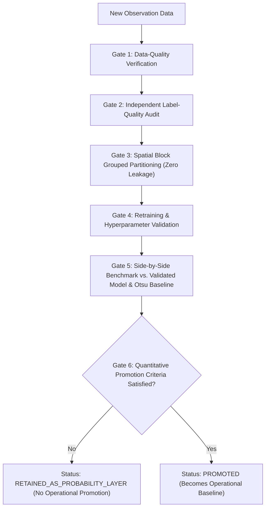

# Earth Pulse — Safe Model Updating & Governance Protocol
**Project:** NASA Space Apps Challenge 2026 — *"Dancing with the SARs"*  
**System:** Earth Pulse Machine Learning Governance & Quality Control  
**Document Version:** 1.0.0  
**Effective Date:** November 3, 2026  

---

## 1. Principles of Scientific Model Updating

In operational disaster response and flood-risk mapping, uncontrolled model updating introduces silent failure modes:
1. **Feedback Loops & Error Cascades (Auto-Degradation):**
   Using a model's own predictions as pseudo-labels without independent physical verification causes the model to amplify its existing systematic errors (e.g., misclassifying wet sandbars as water). Over successive retraining iterations, pseudo-labeling causes catastrophic specificity collapse.
2. **Concept Drift & Regional Overfitting:**
   Random Forest is an ensemble of decision trees trained in batch; it is **not an online-learning algorithm**. Incremental updates must be executed via controlled retraining on versioned, audit-proof training corpora.
3. **Spatial Data Leakage:**
   Adding new geographic observations without spatial block isolation creates spatial autocorrelation between training samples and evaluation pixels, yielding falsely optimistic accuracy metrics.

---

## 2. The 6-Stage Gated Update Protocol

Every model retraining or fine-tuning run must pass through six sequential gate checks before any candidate model can be serialized or registered:

### Gate 1: Data-Quality Verification
- Calibration accuracy: verify sigma0 calibration in dB.
- Speckle filtering: verify adaptive filter parameters (e.g. Lee 5x5).
- Radio-frequency interference (RFI) check: mask pixels exceeding physical bounds (VV > +15 dB, VH > +5 dB).
- Quality mask enforcement: apply NoData to shadow, layover, and invalid edge pixels.

### Gate 2: Independent Label-Quality Audit
- **Strict Label Independence:** Labels must originate exclusively from verified independent sources (e.g. Sentinel-2 MSI SCL Class 6 Water vs Class 5 Bare ground, high-resolution optical imagery, or hydrometric gauge networks).
- **Prohibition of Self-Supervision:** Model probability maps or predicted masks from prior iterations are **strictly forbidden** from entering training sets.
- **Vegetation Exclusion:** Double-bounce and emergent vegetation (SCL Class 4) must remain masked unless verified sub-canopy water level gauges are present.

### Gate 3: Spatial Leakage Prevention
- Partitioning must occur at the **$1\text{ km} \times 1\text{ km}$ spatial block level** ($50 \times 50\text{ pixels}$).
- If training across multiple regions, blocks must be prefixed with their region identifier (`<region_id>:<block_id>`) to prevent index collision.
- Verification assertion:
  $$\text{Intersection}(\text{TrainBlocks}, \text{ValidationBlocks}) = \emptyset$$
  $$\text{Intersection}(\text{TrainBlocks}, \text{TestBlocks}) = \emptyset$$
  $$\text{Intersection}(\text{ValidationBlocks}, \text{TestBlocks}) = \emptyset$$

### Gate 4: Retraining & Hyperparameter Validation
- Retraining must be executed deterministically with fixed random seeds (`seed=42`).
- Hyperparameters (`n_estimators`, `max_depth`, `min_samples_leaf`) and probability threshold ($\tau^*$) must be optimized **exclusively on validation blocks**.
- Held-out test blocks must remain strictly quarantined during tuning.

### Gate 5: Side-by-Side Model Benchmarking
The candidate model must be evaluated on identical held-out test pixels against:
1. The currently registered validated model version (e.g., `phase7a_rf_jamuna_v1`).
2. The primary deterministic operational baseline (**Lee 5x5 Dual-AND Otsu**).

### Gate 6: Quantitative Promotion Criteria
To be promoted to replace the primary operational baseline, the candidate model must achieve **unambiguous Pareto improvement**:
- $\text{Held-out Test Precision} \ge 0.5500$
- $\text{Held-out Test Recall} \ge 0.7000$
- $\text{Held-out Test Specificity} \ge 0.7000$
- $\text{Held-out Test F1-Score} \ge 0.6000$
- $\text{Cross-temporal transfer degradation} < 20\%$

If a candidate model fails any of these criteria (e.g., high recall but poor specificity due to false alarms on agricultural fields), it is registered with status **`RETAINED_AS_PROBABILITY_LAYER`** and the deterministic baseline remains the official operational product.

