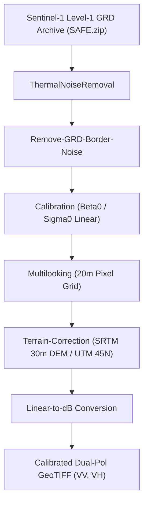

# Earth Pulse SAR — Scientific Methodology & Remote Sensing Architecture
**NASA Space Apps Challenge 2026: Dancing with the SARs**  
**Core Discipline:** Synthetic Aperture Radar (SAR) Hydrology, Geomorphology & Geospatial Machine Learning

---

## 1. SAR Preprocessing & Radiometric Calibration

Synthetic Aperture Radar (SAR) imagery from the Sentinel-1 C-band (5.405 GHz) sensor operates day-and-night and penetrates monsoon cloud cover, making it the premier instrument for flood dynamics and riverbank erosion monitoring in Bangladesh's Brahmaputra-Jamuna basin.

### 1.1 Canonical ESA SNAP Preprocessing Graph
Sentinel-1 Level-1 Ground Range Detected (GRD) Interferometric Wide (IW) dual-polarization (VV+VH) products are ingested and processed through ESA SNAP using the canonical 8-node XML workflow template (`graphs/s1_grd_calibration_terrain_correction.xml`, SHA-256: `c239c2691ebcf45b778e171553c1656f9ce4d4a1dded160d929fa8e73cf316a0`):

1. **Thermal Noise Removal**: Strips additive thermal noise across sub-swaths using metadata-provided noise look-up tables (LUTs).
2. **GRD Border Noise Removal**: Eliminates false low-intensity boundary artifacts at the edges of swaths.
3. **Radiometric Calibration**: Converts raw digital numbers ($DN$) into physical radar backscatter coefficient $\sigma^0$ (Sigma Nought) in linear power units.
4. **Multilooking**: Spatially averages the radar signal (2 range looks $\times$ 2 azimuth looks) to attenuate high-frequency speckle noise, yielding nominal 20-meter square ground resolution.
5. **Range Doppler Terrain Correction**: Corrects geometric distortions (foreshortening, layover, shadow) using the high-resolution Copernicus/SRTM 30m Digital Elevation Model (DEM) and projects output rasters into UTM Zone 45N (EPSG:32645).
6. **Polarization Mapping Integrity**: Every processed scene independently establishes band metadata before and after warping, verifying that Band 1 corresponds to $\text{Sigma0\_VH}$ and Band 2 corresponds to $\text{Sigma0\_VV}$ without blind assumption.

### 1.2 Decibel Transformation & Speckle Filtering
Linear backscatter power is transformed into logarithmic decibels ($\text{dB}$):
$$\sigma^0_{\text{dB}} = 10 \cdot \log_{10}(\sigma^0_{\text{linear}})$$

A refined $3 \times 3$ Lee speckle filter is applied to suppress multiplicative speckle noise while preserving sharp boundaries between water surfaces and land cover.

---

## 2. Dynamic Water Classification (Calibrated Otsu)

Specular reflection of C-band radar waves off open water surfaces scatters radar energy away from the sensor, producing characteristically low backscatter values (typically $\sigma^0_{\text{VV}} < -16.5\text{ dB}$).

### 2.1 Dual-Polarization Otsu Thresholding
The pipeline computes automated thresholds using Otsu's variance maximization algorithm on the VV decibel backscatter distribution within the study AOI:
$$\sigma^2_B(t) = \omega_0(t) \omega_1(t) \left( \mu_0(t) - \mu_1(t) \right)^2$$
Where $\omega_0(t), \omega_1(t)$ are class probabilities and $\mu_0(t), \mu_1(t)$ are class means separated by threshold $t$.
- Water surfaces: $\sigma^0_{\text{VV}} \le t_{\text{Otsu}}$
- Non-water land: $\sigma^0_{\text{VV}} > t_{\text{Otsu}}$
- Sensor noise floor: Values below $-28.0\text{ dB}$ are classified as indeterminate noise floor rather than open water.

---

## 3. Common-Domain Flood Transition Accounting

To prevent boundary misalignment artifacts, flood change detection is strictly executed on the spatial intersection of valid observation domains ($M_{\text{valid}} = M_{T1} \cap M_{T2}$).

### 3.1 6-Class Transition Model
Each pixel in the common domain is classified into one of six mutually exclusive states:
1. **Class 1 — Persistent Water**: Water observed at both T1 and T2 ($W_{T1} \land W_{T2}$). Color: `#08519c`.
2. **Class 2 — Newly Inundated (Flood Expansion)**: Dry land at T1 transitioning to water at T2 ($(\neg W_{T1}) \land W_{T2}$). Color: `#41b6c4`.
3. **Class 3 — Receded Water (Flood Recession)**: Water at T1 transitioning to dry land at T2 ($W_{T1} \land (\neg W_{T2})$). Color: `#fe9929`.
4. **Class 4 — Persistent Non-Water Land**: Dry land at both T1 and T2 ($(\neg W_{T1}) \land (\neg W_{T2})$). Color: `#cccccc`.
5. **Class 5 — Indeterminate Noise Floor**: Pixels beneath the sensor sensitivity threshold at either date. Color: `#a6cee3`.
6. **Class 6 — Outside AOI / NoData**: Pixels outside the analysis polygon or missing valid satellite coverage. Rendered as fully transparent (`#00000000`).

### 3.2 Mathematical Accounting Invariant
The change accounting engine enforces strict mathematical conservation:
$$\Delta W_{\text{net}} = A_{\text{newly\_inundated}} - A_{\text{receded}} \equiv A_{T2} - A_{T1}$$
- **January 2025 Live Validation:**
  - $A_{T1} = 11.9852\text{ km²}$, $A_{T2} = 13.0292\text{ km²}$
  - $A_{\text{newly\_inundated}} = 1.6160\text{ km²}$, $A_{\text{receded}} = 0.5720\text{ km²}$
  - $\Delta W_{\text{net}} = 1.6160 - 0.5720 = \mathbf{+1.0440\text{ km²}}$ (Discrepancy: $0.0000\text{ km²}$)
- **Historical 2024 Monsoon Validation:**
  - $\Delta W_{\text{net}} = \mathbf{+5.8432\text{ km²}}$ (Discrepancy: $0.0000\text{ km²}$)

---

## 4. Riverbank Dynamics & Quality-Gate Algorithm

The Jamuna River is a dynamic braided river with frequent channel shifting, sandbar (*char*) formation, and intense bankline migration.

### 4.1 2D Connected-Component Quality Gate
Traditional single-row 1D thresholding produces severe false bank displacements when agricultural pooling or disconnected floodplain water appears near the river channel.

The Earth Pulse pipeline enforces a two-tier spatial correspondence quality gate:
1. **2D Morphological Component Labeling**: Identifies contiguous water bodies. Small disconnected water bodies outside the main channel are quarantined.
2. **Temporal Intersection-over-Union (IoU)**: Evaluates overlap of the active channel polygon between T1 and T2:
   $$\text{IoU} = \frac{\text{Area}(C_{T1} \cap C_{T2})}{\text{Area}(C_{T1} \cup C_{T2})}$$
   Transects across multi-braid bifurcations or disconnected floodplain water failing the correspondence threshold ($\text{IoU} < 0.40$) are tagged as `UNQUALIFIED` and suppressed from the authoritative migration statistics.

### 4.2 January 2025 Riverbank Measurements
- Total Transects Evaluated: 36
- Qualified Reliable Transects: 35
- Rejected Ambiguous Transects: 1 (Row 396, quarantined due to isolated floodplain water)
- Mean Left Bank Displacement: $+45.71\text{ meters}$
- Mean Right Bank Displacement: $+1.71\text{ meters}$
- Maximum Observed Bank Displacement: $360.0\text{ meters}$

---

## 5. Machine Learning Water Probability & Saabas Explainability

### 5.1 Frozen Random Forest Architecture
A frozen Random Forest artifact (`phase7a_random_forest_model.joblib`, SHA-256: `85038f0fbd832acc373706d7e262a7464142c0c86b4c3ffb1ac1839edf5b53ad`) supplies an experimental candidate-water probability layer. Its registered contract is 40 trees, maximum depth 6, minimum leaf size 10, and six features in this exact order:
1. `vv_db`: VV backscatter in dB.
2. `vh_db`: VH backscatter in dB.
3. `vv_minus_vh_db`: VV minus VH in dB.
4. `cross_pol_ratio`: linear VV/VH power ratio, clipped to [0, 100].
5. `texture_vv`: local 5×5 standard deviation of VV in dB.
6. `texture_vh`: local 5×5 standard deviation of VH in dB.

The archive's model registry records the model as Jamuna-only and retains adaptive Lee 5×5 dual-polarization Otsu as the primary operational classification baseline. The RF probabilities are not calibrated flood risk and have not been shown to generalize to other rivers.

### 5.2 Saabas Local Additive Feature Attributions
For supported sample predictions, local explainability decomposes decision paths through the 40 trees:
$$f(x) = \text{base\_value} + \sum_{i=1}^{6} \phi_i(x)$$
Where $\phi_i(x)$ represents the contribution of feature $i$ to the predicted water probability relative to the dataset baseline prior. The implementation verifies tree additivity on every run, guaranteeing $|\sum \phi_i - (f(x) - \text{base})| < 10^{-6}$.

